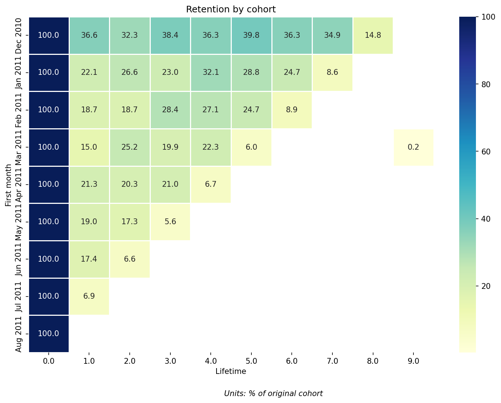
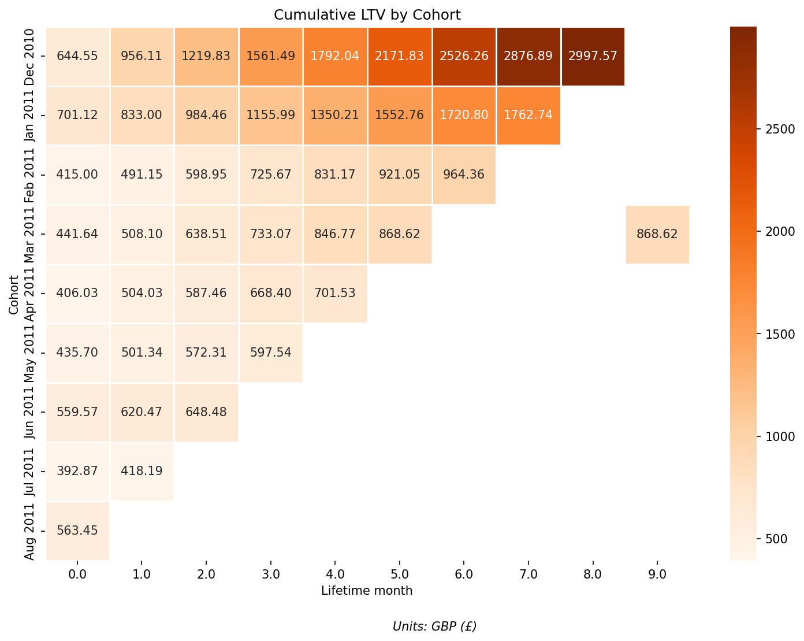
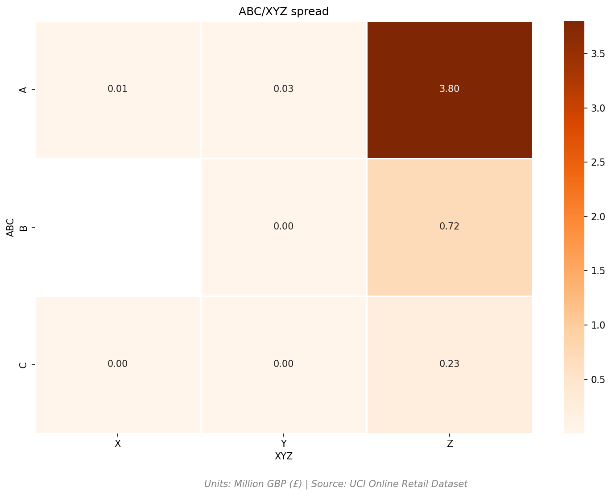
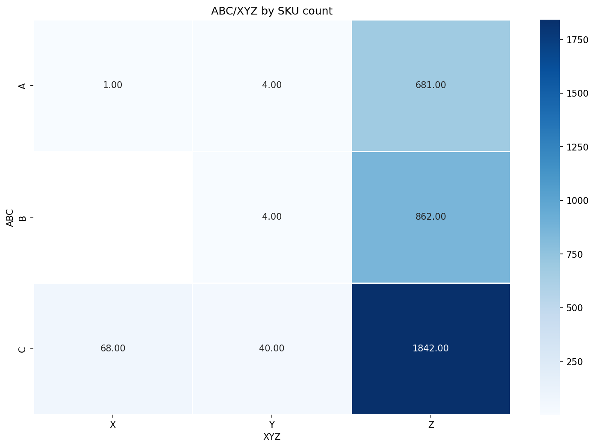
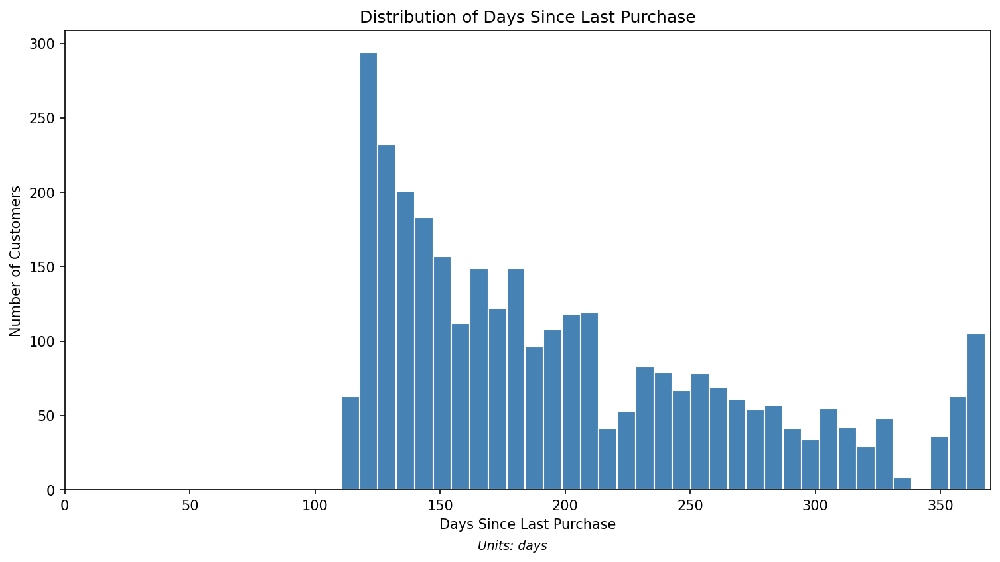
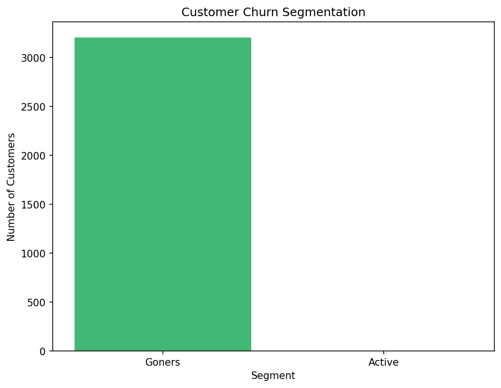
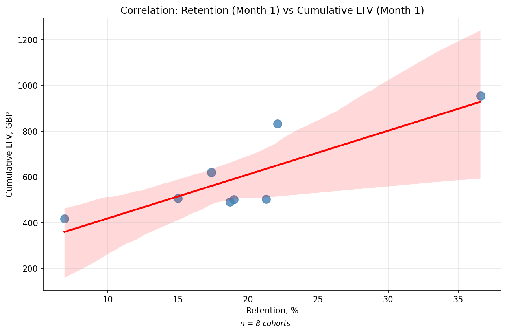
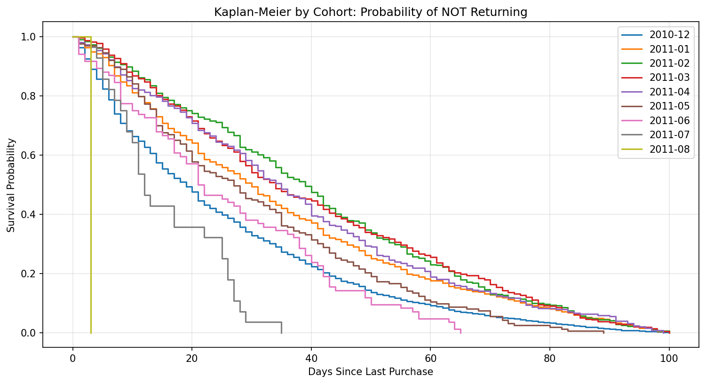

# Анализ клиентской базы интернет-магазина (SQL + Python)

Когортный анализ, ABC/XYZ-сегментация, Churn и Survival Analysis 
с проверкой статистической значимости (Wilson CI, z-test, chi-square, log-rank).

## Задача: 
### Проанализировать клиентскую базу и ассортимент интернет-магазина подарков, ответив на вопросы:
### – Как удерживаются клиенты по когортам? (Retention, ARPU, LTV)
### – Какие товары приносят основную выручку и насколько стабилен спрос на них? (ABC/XYZ)
### – Какая доля клиентов уходит и можно ли это объяснить сезонностью? (Churn, Survival)
### – Различаются ли когорты статистически значимо? (CI, z-test, log-rank)

### Данные: UCI Online Retail, 2010-2011, UK, GBP, ~540K транзакций. Источник: https://archive.ics.uci.edu/dataset/352/online+retail

### Стек: PostgreSQL 18, Python 3.13, pandas, SQLAlchemy, seaborn, matplotlib, scipy, statsmodels, lifelines, python-dotenv

## Структура БД: 

### Исходные данные: 
#### retail – транзакции (customerid, stockcode, quantity, unitprice, invoicedate, ...)

### Промежуточные данные:
#### rfm – rfm-сегментация клиентов
#### avg_median – медианный промежуток между покупками (для churn) 

### Materialized view: 
#### abc, xyz, abc_xyz_matrix – классификация товаров и сводная матрица  
#### xyz_revenue, abc_xyz_revenue – классификация товаров по выручке и сводная матрица
#### arpu_cltv – когорты с retention, ARPU и LTV
#### churn — распределение клиентов по статусу

### Views: 
#### survival_gaps_cohorts, survival_gaps – наблюдения для Kaplan-Meier

## Когортный анализ

### Retention 
#### Задача: понять, как удерживаются клиенты по месяцам.
#### Метод: группировка по месяцу первой покупки, расчет retention через оконные функции и вывод в MATERIALIZED VIEW arpu_cltv. 
#### Вывод: когорта Dec 2010 удерживает лучше всех (36.6% на 1-й месяц), Jul 2011 — хуже всех (6.9%). К 8-му месяцу retention Dec 2010 = 14.8%.



*Рис. 1. Retention по когортам*

### LTV
#### Задача: рассчитать накопленную ценность клиента по когортам
#### Метод: ARPU = revenue / cohort_total, cumulative LTV через SUM(arpu) OVER (PARTITION BY first_month ORDER BY lifetime_month)
#### Вывод: когорта Dec 2010 к 8-му месяцу накопила cumulative LTV £2997 — лояльное ядро приносит основную выручку.



*Рис. 2. Cumulative LTV по когортам*

### ABC/XYZ 
#### Задача: сегментировать ассортимент по выручке и стабильности спроса
#### Метод: ABC — накопительный % выручки через SUM() OVER, XYZ — коэффициент вариации (STDDEV/AVG)
#### Вывод: класс A-Z дает £3.8M выручки, а класс C-Z — 1842 SKU приносят £0.23M. Ассортимент перегружен «хвостом»: 20% товаров дают 95% выручки – закон Парето подтверждён.



*Рис. 3. ABC/XYZ-матрица по выручке*



*Рис. 4. ABC/XYZ-матрица по количеству SKU*

### Churn
#### Задача:  определить, какая доля клиентов уходит, и объясняется ли отток сезонностью
#### Метод:  LAG() для разрывов между покупками, расчет медианного промежутка и среднего 
#### Вывод: распределение бимодальное — клиенты либо покупают прямо сейчас, либо уходят на 116+ дней. Предположение – это объясняется сезонностью, а не классическим оттоком в виду специфики ассортимента. Гипотеза подтверждена в survival analysis (все клиенты, покупавшие после августа 2011, успели вернуться).



*Рис. 5. Распределение дней с последней покупки*



*Рис. 6. Сегментация клиентов*

## Статистический анализ 

### Доверительные интервалы для retention (Wilson CI)

#### Задача: оценить точность точечных значений retention и понять, где оценка надёжна, а где — шум из-за малой выборки.
#### Метод: Wilson CI для пропорций при 95% уровне значимости. Для каждой когорты рассчитан интервал вокруг точечной оценки retention.
#### Вывод: Dec 2010 имеет узкий интервал [33.5; 39.8] — оценка надёжна (n = 885). Jul 2011 — широкий [4.1; 11.5] (n = 188), что говорит о высокой неопределённости из-за малой выборки. Интервалы Apr, May, Jun пересекаются, значит наблюдаемые различия между ними могут быть шумом, а не реальным изменением поведения клиентов.

### Z-test для сравнения когорт

####  Задача: определить, какие различия в retention между когортами статистически значимы, а какие — случайность.
####  Метод: z-test для двух пропорций, попарное сравнение всех 8 когорт (28 пар), порог значимости p < 0.05.
####  Вывод:  –  Декабрь 2010 значимо отличается от всех остальных когорт (p < 0.001), подтверждая, что эта когорта действительно удерживает клиентов лучше;
####          – Июль 2011 значимо хуже всех (p < 0.01) — возможно, из-за неполных данных или сезонного спада;
####          – Различия между когортами Январь-июль 2011 статистически незначимы (p > 0.05) — наблюдаемые колебания retention в этом диапазоне объясняются размером выборки, а не реальным изменением поведения клиентов.

### Корреляция retention и LTV

#### Задача: проверить гипотезу о взаимосвязи между retention и LTV 
#### Метод: Формулы Spearman и Pearson по 1-ому месяцу каждой когорты. 
#### Вывод: Между retention (месяц 1) и cumulative LTV наблюдается положительная связь. Pearson r = 0.839 (p = 0.009) указывает на сильную линейную зависимость. Однако Spearman r = 0.643 (p = 0.085) не подтверждает значимость ранговой связи — это объясняется малой выборкой (8 когорт) и наличием выбросов. Уверенный вывод дать невозможно, нужны данные за больший период времени.



*Рис. 7. Scatter plot: retention (месяц 1) vs cumulative LTV*


### Chi-square для ABC/XYZ

#### Задача: Проверить, зависит ли XYZ-класс (стабильность спроса) от ABC-класса (вклад в выручку).
#### Метод: chi-square тест на независимость для таблицы сопряжённости 3×3, Cramér's V как мера силы связи. Дополнительно проведён sensitivity analysis — пересчёт XYZ по выручке вместо quantity.
#### Вывод: связь статистически значима (χ² = 68.54, p < 0.001), но слабая (Cramér's V = 0.099). Пересчёт XYZ по выручке дал идентичный результат (V = 0.098) — вывод устойчив к выбору метрики. 
#### Причина слабой связи — 96–99% товаров попадают в класс Z независимо от ABC-класса (особенность датасета: большинство товаров покупаются нерегулярно).

### Survival analysis и log-rank test
#### Задача: измерить «скорость возврата» клиентов после предыдущей покупки и проверить, различается ли поведение когорт.
#### Метод: Кривая Kaplan-Meier, кривые по когортам. Выборка за первые 100 дней когорты. Log-rank test.
#### Вывод: Kaplan-Meier анализ с общим окном наблюдения 100 дней показал, что когорта Dec 2010 значимо быстрее возвращает клиентов (log-rank test, p < 0.001). Кривые выживаемости идут параллельно, что говорит об устойчивой разнице в поведении клиентов. Когорта Aug 2011 исключена из интерпретации из-за недостаточного окна наблюдения.



*Рис. 8. Кривые выживаемости по когортам (окно — первые 100 дней)*

## Ключевые выводы

### 1. Когорта Dec 2010 — лидер по удержанию и ценности.
#### К 8-му месяцу retention = 14.8%, cumulative LTV = £2997 на клиента. По z-test когорта значимо отличается от всех остальных (p < 0.001). По survival analysis — быстрее всех возвращает клиентов (log-rank test, p < 0.001). Это ядро, на котором держится выручка магазина.

### 2. Ассортимент перегружен хвостом.
#### 20% товаров дают 95% выручки — закон Парето подтверждён. Класс A-Z приносит £3.8M, класс C-Z — 1842 SKU приносят всего £0.23M. Магазину стоит задуматься о сокращении неликвидного ассортимента. Однако, это прямой статистический вывод, в реалиях бизнес-анализа сокращение ассортимента может косвенно привести к негативным последствиям

### 3. Отток обусловлен сезонностью, а не уходом клиентов.
#### Распределение дней с последней покупки бимодальное: клиенты либо покупают прямо сейчас, либо отсутствуют 116+ дней. Все клиенты, покупавшие после августа 2011, успели вернуться хотя бы раз — это подтверждает сезонный паттерн, а не классический отток.

### 4. Клиенты возвращаются в среднем за 38 дней.
#### Медианный интервал между покупками = 27 дней, средний = 38 дней. То есть если клиент не вернулся за 38 дней — он в «зоне риска». Это окно для триггерных коммуникаций (письма-напоминания, промокоды).

### 5. ABC и XYZ слабо связаны.
#### Chi-square показал значимую, но слабую связь (χ² = 68.54, p < 0.001, Cramér's V = 0.099). Причина — 96–99% товаров попадают в класс Z независимо от ABC-класса. Пересчёт XYZ по выручке подтвердил устойчивость вывода.

##  Ограничения анализа

### 1. Недостаточное окно наблюдения.
#### Датасет охватывает период 2010-12-01 — 2011-12-09. Полноценный анализ сезонности (ACF, STL-декомпозиция) невозможен: требуется минимум 2–3 полных сезонных цикла. Косвенные признаки сезонности обнаружены в Churn- и Survival-анализе, но строгое подтверждение требует расширенного датасета.

### 2. Малая выборка когорт (8 штук).
#### При n = 8 статистическая мощность ограничена. Например, корреляция retention и LTV показывает конфликт между Pearson (r = 0.839, p = 0.009) и Spearman (r = 0.643, p = 0.085) — для строгого вывода требуется больше когорт.

### 3. Диспропорциональное распределение по XYZ
#### На первый взгляд данные кажутся ошибочными. Однако пересчёт по выручке не изменил результата. Значит, это свойство датасета, а не ошибка метода.

### 4. Резкий обрыв данных в декабре 2011.
#### Клиенты, покупавшие в конце периода, не успели «прожить» достаточно времени для полноценного анализа. Это ограничивает интерпретацию поздних когорт.

##  Как воспроизвести
### 1. Скопировать репозиторий
#### - ```bash git clone https://github.com/BladeofQuequela/UCI_retail_analysis.git ```
### 2. Создать БД и загрузить данные.
#### - Создать базу `crm` в PostgreSQL.
#### - Импортировать `Online Retail.xlsx` в таблицу `retail`.
#### - Запустить SQL-скрипты из папки `sql/` (создание MV).
#### 3. Настроить переменные окружения:**
#### - Скопировать `.env.example` в `.env`:
####   `cp .env.example .env`
#### - В файле `.env` заменить `insert_your_password` на свой пароль от PostgreSQL:
####  `insert_your_password=ваш_пароль`
### 4. Установить зависимости (requirements.txt).
####   `pip install -r requirements.txt`
### 5. Запустить Python-скрипты по порядку.
#### - `vis_cohorts.py`, `vis_ltv.py` — визуализация когорт.
#### - `vis_abc_xyz.py`, `vis_abc_xyz_count.py` — ABC/XYZ.
#### - `vis_churn.py` — Churn.
#### - `CI.py`, `Chi^2.py`, `Cor retLTV.py`, `Survival_rate.py` — статистика.
### 6. Проверить результат
#### Все графики сохраняются в `images/`, README отображается в Preview.

## Дальнейшие шаги
### 1. Расширить датасет.
#### Объединить с UCI Online Retail II (2009–2011) для полноценного ACF/STL-анализа сезонности. Это закроет главное ограничение проекта.

### 2. A/B-тест как отдельный кейс.
#### Провести полноценный A/B-тест на синтетических или открытых данных: дизайн эксперимента, расчёт MDE, z-test для конверсий, интерпретация результатов. Это обязательный навык продуктового аналитика.

### 3. Дашборд в Superset или Power BI.
#### Собрать интерактивный дашборд с ключевыми метриками (Retention Heatmap, LTV, ABC/XYZ, Churn) для демонстрации в портфолио.

### 4. Прогнозирование LTV.
#### Использовать регрессионные модели (BG/NBD, Gamma-Gamma) из библиотеки lifelines для прогноза будущей ценности клиентов.